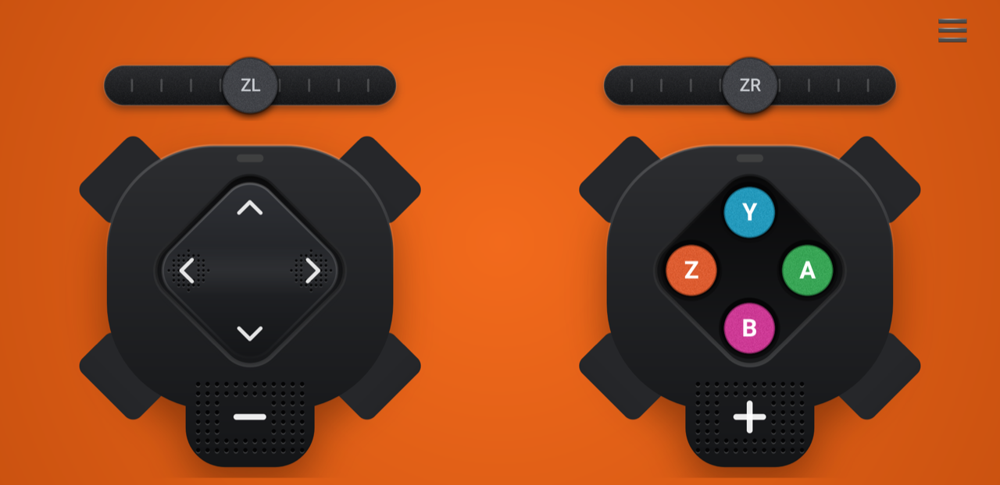
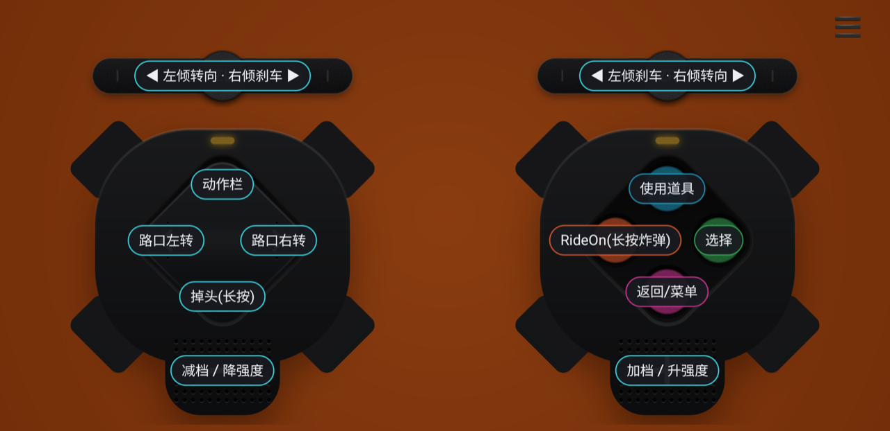
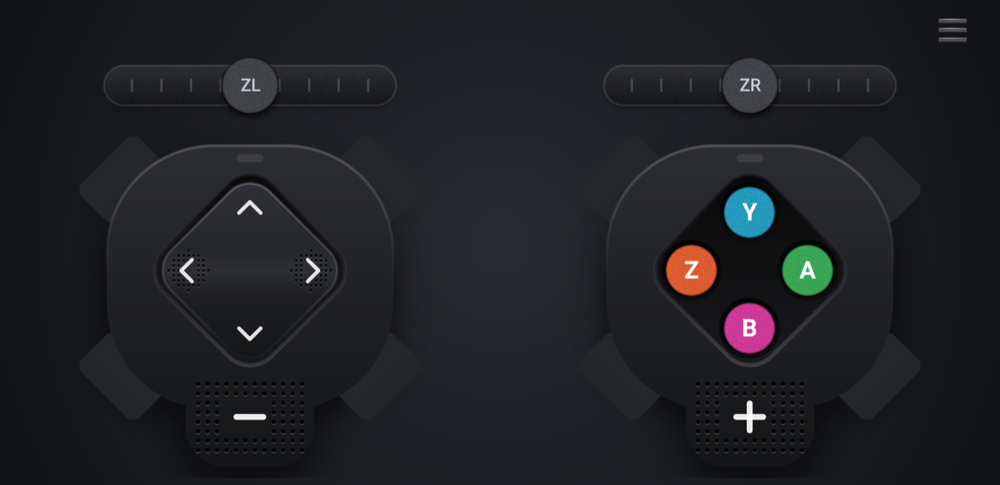
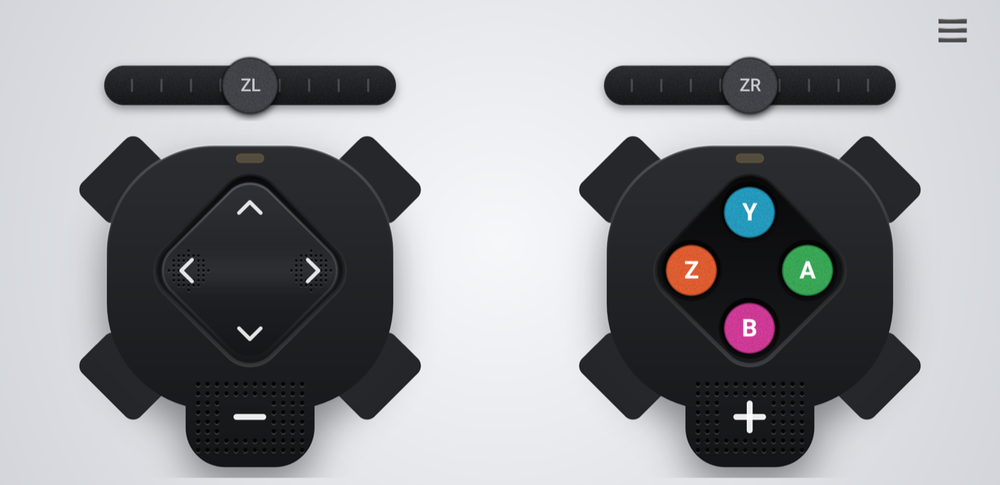
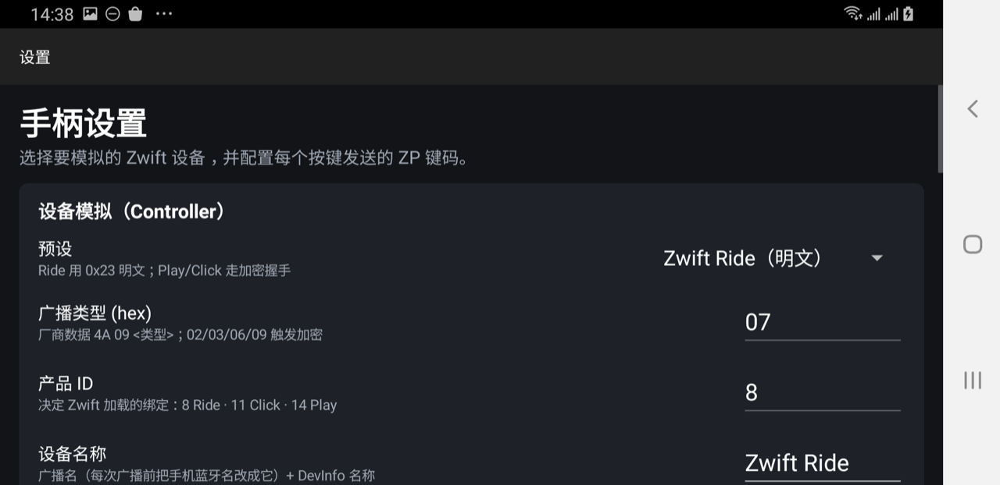
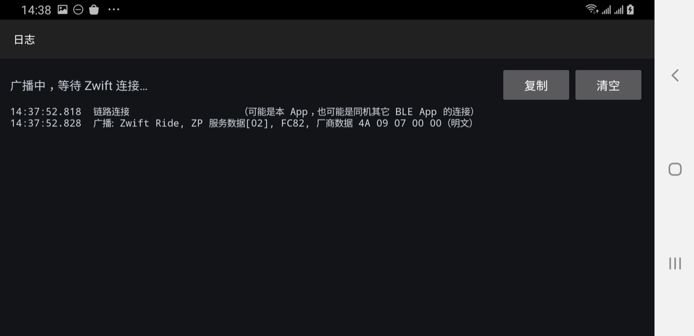

# Zwift Joypad for Android

**English** | [中文](#中文)

Turn your Android phone into a virtual **Zwift Ride–style controller**. The app advertises itself over Bluetooth LE, pairs with Zwift as a **Controls** device, and sends button presses and steering input. It also receives in-game haptic events (collisions, Ride Ons, power-ups…) and vibrates the phone.

> Unofficial hobby project. Not affiliated with, endorsed by, or supported by Zwift, Inc. "Zwift", "Zwift Ride", "Zwift Play" and "Zwift Click" are trademarks of their respective owners.



## Features

- **Virtual controller over BLE**: shows up in Zwift's pairing screen under *Controls* as "Zwift Ride". No extra hardware, no PC-side software.
- **Full button set**: D-pad, Y / Z / A / B, shift down (−) / shift up (＋), and two analog **ZL / ZR steering paddles** (tilt to steer, tilt the other way to brake). Multi-touch, so you can steer and press buttons at the same time.
- **Default Zwift actions**: turn left/right at intersections, U-turn (hold), action bar, power-up, Ride On / Ride On bomb (hold), select, back, shift up/down, and workout intensity in workout mode.
- **Haptic events from Zwift**: collisions, road edge, Ride On, power-up, shift limit, hazards… The event name is shown briefly at the top of the screen and the phone vibrates (both optional).
- **Zwift Click–inspired UI**: matte black controller bodies, a one-piece D-pad rocker, frosted Y/Z/A/B keys, textured −/＋ keys, and paddles with a raised knob. Landscape and full screen.
- **Status LEDs**: grey when stopped, breathing yellow while advertising, solid cyan when Zwift is connected.
- **Button hints on demand**: tap any empty area to fade in an overlay that labels every control with its Zwift action. It hides by itself after a few seconds.
- **Configurable**:
  - remap any on-screen control to any controller key code;
  - choose the analog channel for each paddle, invert it, and set its range;
  - background theme: Zwift orange / dark / light;
  - vibration, event toasts, auto-start advertising;
  - device emulation presets.
- **Protocol log** screen with copy/clear, also mirrored to logcat (`adb logcat -s ZwiftJoystick`).

| Button hints | Dark theme | Light theme |
|---|---|---|
|  |  |  |

| Settings | Log |
|---|---|
|  |  |

## Requirements

- An Android phone with **Bluetooth LE peripheral (advertising) support**, Android 8.0+ (API 26). Tested on a Samsung Galaxy S8+ (Android 9).
- Zwift on a computer or tablet with Bluetooth (tested with Zwift for macOS).

## Build

Requirements: JDK 17 and the Android SDK (compileSdk 35). The Gradle wrapper (Gradle 8.9, AGP 8.7.3) is included.

```bash
git clone https://github.com/rainyx/zwift-joypad-android.git
cd zwift-joypad-android
echo "sdk.dir=/path/to/Android/sdk" > local.properties   # or set ANDROID_HOME
./gradlew assembleDebug
adb install -r app/build/outputs/apk/debug/app-debug.apk
```

You can also open the project in Android Studio and press *Run*.

The only third-party dependency is BouncyCastle (`bcprov-jdk18on`), used for the optional encrypted device modes.

## Usage

1. Open the app. It starts advertising automatically: the LEDs breathe yellow.
2. In Zwift, open the **Pairing** screen → **Controls**, and pick **Zwift Ride**.
3. Once connected, the LEDs turn cyan and you can ride:
   - ZL / ZR paddles: steer and brake
   - D-pad ◀ ▶: turn at intersections; ▼ (hold): U-turn
   - Y: power-up; Z (hold): Ride On bomb
   - − / ＋: shift down / up
4. Tap an empty area at any time to see what each control does.
5. **☰ menu**: start / stop / restart advertising, send battery level, open **Log** or **Settings**.

### Tips

- The app renames the phone's Bluetooth name to the device name in *Settings* (default "Zwift Ride") before advertising, so that Zwift lists it correctly.
- Android shares one Bluetooth name and one GATT database across all apps. Running another BLE peripheral app (e.g. a trainer simulator) on the same phone can confuse Zwift, so run only this app while pairing.
- Zwift may list several "Zwift Ride" entries over time: Android rotates the advertising address. Pick the one that connects.

## Project layout

```
app/src/main/java/com/zwiftjoystick/
├── App.java               Application: holds the BLE peripheral, settings and log
├── ZwiftPeripheral.java   BLE advertising, GATT server, controller session, input reports
├── ZpCrypto.java          Session crypto for the encrypted device presets
├── Pb.java / Hex.java     Minimal protobuf encoder/decoder and hex helpers
├── Prefs.java             Settings and key maps
├── MainActivity.java      Landscape controller screen + menu
├── SettingsActivity.java  Settings
├── LogActivity.java       Protocol log
└── ui/                    ControllerBody, DpadView, PadButton, PaddleView, ClusterLayout, HintOverlay, Grain
```

## Status

- Verified with real Zwift (macOS): pairing as a Controls device, connection, device info, input configuration, battery, and haptic events.
- The Ride preset (unencrypted) is the default and the one that's been tested. The Play / Click presets (encrypted) are experimental.

## License

[MIT](LICENSE) © 2026 rainyx

---

<a name="中文"></a>

# Zwift Joypad for Android（中文）

[English](#zwift-joypad-for-android) | **中文**

把 Android 手机变成一个虚拟的 **Zwift Ride 风格手柄**。App 通过蓝牙 LE 广播自己，在 Zwift 里作为**控制器（Controls）**配对，把按键和转向输入发给 Zwift；同时接收游戏里的震动事件（碰撞、RideOn、道具……），让手机跟着震动。

> 非官方的个人兴趣项目，与 Zwift, Inc. 无任何关联，也未获其认可或支持。"Zwift"、"Zwift Ride"、"Zwift Play"、"Zwift Click" 为其各自所有者的商标。


## 功能

- **蓝牙虚拟手柄**：在 Zwift 配对页的"控制器"里显示为 "Zwift Ride"，不需要额外硬件，也不需要电脑端软件。
- **完整按键**：十字键、Y / Z / A / B、减档（−）/ 加档（＋），以及两个模拟量 **ZL / ZR 转向拨片**（往一侧拨是转向，往另一侧拨是刹车）。支持多点触控，可以边转向边按键。
- **对应 Zwift 默认动作**：路口左/右转、掉头（长按）、动作栏、使用道具、RideOn / RideOn 炸弹（长按）、选择、返回、加/减档，训练模式下 −/＋ 是降/升强度。
- **Zwift 震动事件**：碰撞、压到路边、RideOn、道具、档位到头、路面危险等。屏幕顶部会短暂显示事件名，手机同时震动（两项都可以关闭）。
- **仿 Zwift Click 的界面**：黑色哑光机身、一体式十字摇板、磨砂质感的 Y/Z/A/B、带纹理的 −/＋ 键、带立体旋钮的拨片；横屏全屏显示。
- **状态灯**：停止时灰色，广播中黄灰交替呼吸，连上 Zwift 后青蓝色常亮。
- **按需显示按键说明**：轻点任意空白处，淡入一层说明，标出每个控件对应的 Zwift 动作，几秒后自动消失。
- **可配置**：
  - 每个屏幕按键都可以改成任意手柄键码；
  - 每个拨片可以选择模拟通道、反向、调整满量程；
  - 背景主题：Zwift 橙 / 深色 / 浅色；
  - 手机震动、事件提示、启动时自动广播；
  - 设备模拟预设。
- **协议日志页**：可复制、清空，同时输出到 logcat（`adb logcat -s ZwiftJoystick`）。

| 按键说明 | 深色主题 | 浅色主题 |
|---|---|---|
|  |  |  |

| 设置 | 日志 |
|---|---|
|  |  |

## 运行要求

- Android 8.0+（API 26），手机需要**支持蓝牙 LE 外设广播**。已在三星 Galaxy S8+（Android 9）上测试。
- 运行 Zwift 的电脑或平板需要有蓝牙（已在 macOS 版 Zwift 上测试）。

## 编译

需要 JDK 17 和 Android SDK（compileSdk 35）。项目自带 Gradle Wrapper（Gradle 8.9 / AGP 8.7.3）。

```bash
git clone https://github.com/rainyx/zwift-joypad-android.git
cd zwift-joypad-android
echo "sdk.dir=/path/to/Android/sdk" > local.properties   # 或设置 ANDROID_HOME
./gradlew assembleDebug
adb install -r app/build/outputs/apk/debug/app-debug.apk
```

也可以直接用 Android Studio 打开项目，点击运行。

唯一的第三方依赖是 BouncyCastle（`bcprov-jdk18on`），只在可选的加密设备模式下用到。

## 使用

1. 打开 App，它会自动开始广播，状态灯呈黄色呼吸。
2. 在 Zwift 里打开 **配对（Pairing）** → **控制器（Controls）**，选择 **Zwift Ride**。
3. 连上后状态灯变成青蓝色，就可以骑了：
   - ZL / ZR 拨片：转向、刹车
   - 十字键 ◀ ▶：路口转弯；▼（长按）：掉头
   - Y：使用道具；Z（长按）：RideOn 炸弹
   - − / ＋：减档 / 加档
4. 随时轻点空白处，查看每个控件的作用。
5. **☰ 菜单**：开始 / 停止 / 重新广播、发送电量、进入**日志**或**设置**。

### 提示

- 每次开始广播前，App 会把手机蓝牙名改成设置里的设备名称（默认 "Zwift Ride"），这样 Zwift 才能正确显示它。
- Android 上所有 App 共用一个蓝牙名和一张 GATT 服务表。如果同一台手机上还运行着其它 BLE 外设 App（比如骑行台模拟器），可能会让 Zwift 识别出错。配对时请只运行本 App。
- Android 会定期更换广播地址，所以 Zwift 里可能会出现多个 "Zwift Ride"，选能连上的那个即可。

## 项目结构

```
app/src/main/java/com/zwiftjoystick/
├── App.java               Application：持有蓝牙外设、设置和日志
├── ZwiftPeripheral.java   BLE 广播、GATT 服务、手柄会话、按键上报
├── ZpCrypto.java          加密设备预设使用的会话加密
├── Pb.java / Hex.java     精简的 protobuf 编解码和十六进制工具
├── Prefs.java             设置与键位表
├── MainActivity.java      横屏手柄主界面与菜单
├── SettingsActivity.java  设置页
├── LogActivity.java       协议日志页
└── ui/                    ControllerBody、DpadView、PadButton、PaddleView、ClusterLayout、HintOverlay、Grain
```

## 当前状态

- 已在真实 Zwift（macOS）上验证：能作为控制器配对、连接，设备信息、输入配置、电量、震动事件都正常。
- 默认的 Ride 预设（不加密）是已测试的模式；Play / Click 预设（加密）仍属实验性质。

## 许可证

[MIT](LICENSE) © 2026 rainyx
